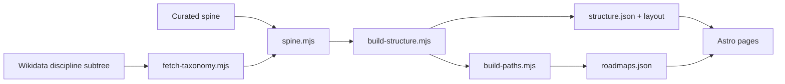

<div align="center">

# Library

**A browsable atlas of human knowledge — 28,649 disciplines under twelve trunks.**

[](https://adineo-cmd.github.io/library/)
     

[](https://github.com/adineo-cmd/library/stargazers) [](https://github.com/adineo-cmd/library/commits)

[Live site](https://adineo-cmd.github.io/library/) · [Quick start](#quick-start) · [How it works](#how-it-works) · [Features](#features)

</div>

---

Library maps the space of human knowledge into something you can actually
navigate: twelve curated trunks, each fanning out into domains, subdomains and
fields. Every one of the **28,649 disciplines** has a place, and the atlas ships
**694 roadmap-style learning paths**.

The structural spine is hand-curated; the long tail comes from Wikidata's
academic-discipline subtree, so labels and links are real.

## Features

| | Feature | What it does |
| --- | --- | --- |
| 🌳 | **Twelve-trunk atlas** | Root → trunk → domain → subdomain → field, all navigable. |
| 🧭 | **694 learning paths** | A stepped path per field, with progress you tick off as you go. |
| ✨ | **Constellation graph** | The whole atlas as a force graph: zoom, pan, isolate a neighbourhood. |
| 🔍 | **Curated structure** | A hand-written spine keeps the top of the tree presentable. |

## How it works

The atlas is built before Astro ever runs:

1. `scripts/fetch-taxonomy.mjs` pulls the Wikidata discipline subtree.
2. `scripts/spine.mjs` applies the hand-curated twelve-trunk structure.
3. `scripts/build-structure.mjs` classifies the pool and computes the layout.
4. `scripts/build-paths.mjs` generates a learning path per field.
5. Astro serves the resulting artifacts from `public/data/artifacts/`.

The legacy Wikipedia-category pipeline is kept for reference but no longer
drives the site — its category graph produced 23,145 orphan roots out of 30,041
nodes, which is why the curated spine exists.



## Quick start

**Install and run**

```bash
npm install
npm run dev
```

**Production build**

```bash
npm run build
npm run preview
```

## Project structure

```text
scripts/
  fetch-taxonomy.mjs   Wikidata → cached edges/labels
  spine.mjs            curated trunks, domains, subdomains
  build-structure.mjs  classify + force layout
  build-paths.mjs      learning paths
src/pages/             atlas, domains, paths, graph
public/data/artifacts/ generated structure and roadmaps
src/components/        Svelte views and graph widgets
```

## Deployment

Every push to `main` builds the site and deploys it to GitHub Pages
through `.github/workflows/deploy.yml`:

**https://adineo-cmd.github.io/library/**

## Rebuilding the artifacts

```bash
npm run ingest           # refresh the Wikidata taxonomy
node scripts/build-structure.mjs
node scripts/build-paths.mjs
npm run dev
```

Tests: `npm test` (vitest) and `npm run test:e2e` (Playwright).
